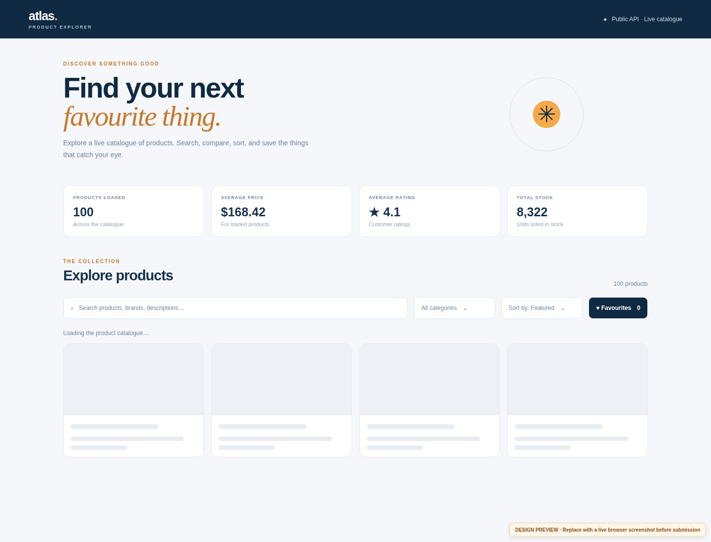
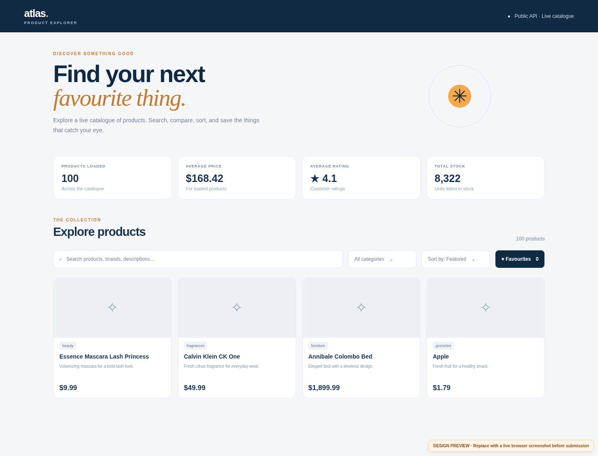
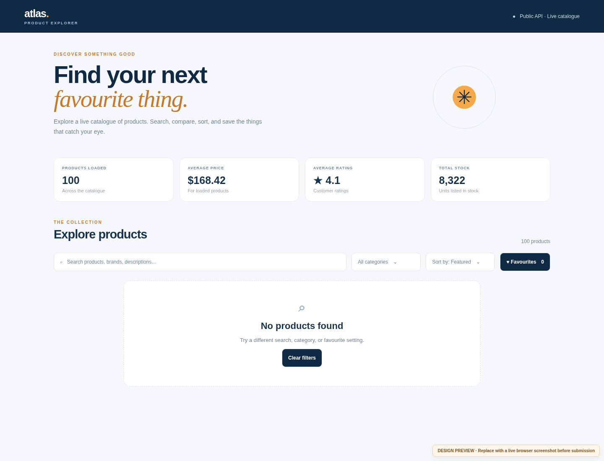
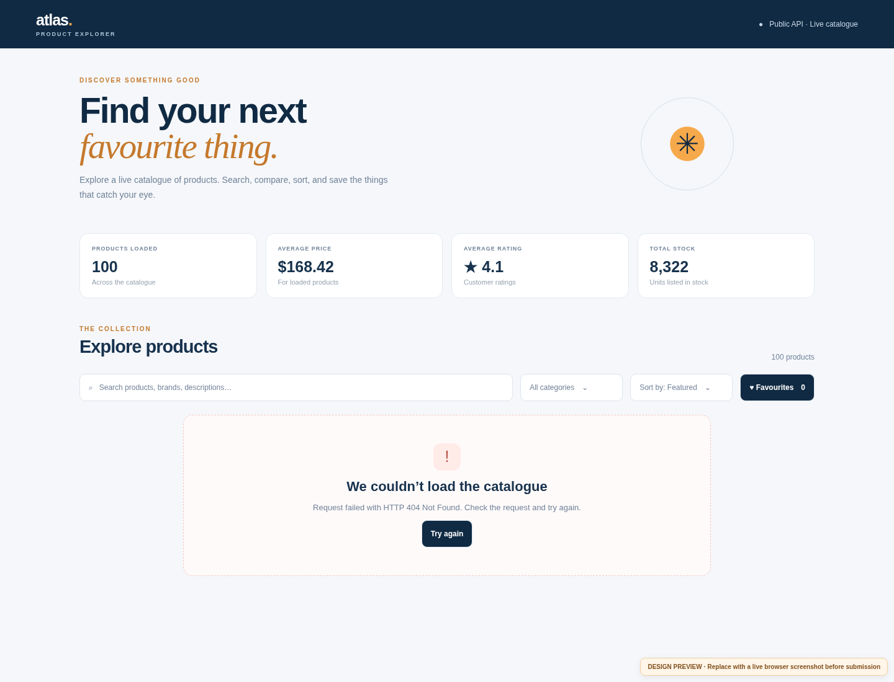

# Atlas — Product Explorer

**Week 5 · Modern JavaScript & Asynchronous Programming**  
**Student:** Iradukunda Flora  
**API:** [DummyJSON Products API](https://dummyjson.com/docs/products)  
**Repository:** `https://github.com/YOUR_GITHUB_USERNAME/week5-async-data-explorer` *(replace after publishing)*  
**Live app:** `ADD_YOUR_DEPLOYED_LINK_HERE`  
**Video walkthrough (3–5 minutes):** `ADD_YOUR_VIDEO_LINK_HERE`

Atlas is a responsive single-page product explorer built with HTML, Tailwind CSS v4, Vite, and vanilla JavaScript ES modules. It uses the built-in `fetch` API only—no Axios or frontend framework.

## Features

- [x] Fetch products automatically when the page opens with `async`/`await`.
- [x] Reusable `getJSON(url)` helper checks `response.ok` and throws helpful errors.
- [x] Loading skeletons, a friendly error state with Retry, and an empty-results state.
- [x] Responsive product cards with safe HTML escaping and missing-value fallbacks.
- [x] Case-insensitive search across product titles, descriptions, and brands.
- [x] Category options derived from the API data, with a fallback if the category request fails.
- [x] Four non-mutating sort choices using `toSorted()`.
- [x] Product details view fetches the selected product by ID.
- [x] Statistics computed with `reduce()` (average price, average rating, total stock).
- [x] Independent product and category requests run together with `Promise.allSettled()`.
- [x] One central state object and a state → derived results → render flow.
- [x] Keyboard-accessible buttons, labelled controls, `aria-live` status messages, and `Escape` to close details.
- [x] Favourites persist in `localStorage`.
- [x] **Bonus:** search input is debounced by 300 ms and favourites are saved locally.

## Screenshots

> **Important:** The images below are labelled design previews, not verified captures of the running app. After running the project, replace them with real browser screenshots of the loading, success, empty, and error states before submitting.

### Loading state


### Success state


### Empty state


### Error state


## State shape and render flow

```js
const state = {
  items: [],
  categories: [],
  visibleItems: [],
  status: 'loading',
  error: null,
  query: '',
  filter: 'all',
  sort: 'default',
  favorites: [],
  favoritesOnly: false,
  selectedProduct: null,
  detailStatus: 'idle',
  detailError: null,
  stats: { count: 0, averagePrice: 0, totalStock: 0, averageRating: 0 },
};
```

When the app opens, `loadCatalogue()` sets the status to `loading` and starts the products and category requests in parallel. `Promise.allSettled()` lets the app show products even if the separate category endpoint fails; categories can then be derived from the products. On success, the app stores the data and computes the statistics. Search, category, sort, and favourite controls update the state without fetching the list again. `getVisibleItems(state)` is a pure helper that filters the existing data and returns a sorted copy when needed. Finally, `render(state)` updates the interface from the current state. Opening a product details view makes one additional request for that product's ID.

## Example API JSON and transformation

A shortened example of the shape returned by `GET https://dummyjson.com/products?limit=100`:

```json
{
  "products": [
    {
      "id": 1,
      "title": "Essence Mascara Lash Princess",
      "description": "The Essence Mascara Lash Princess is a popular mascara.",
      "category": "beauty",
      "price": 9.99,
      "rating": 4.94,
      "stock": 5,
      "thumbnail": "https://cdn.dummyjson.com/product-images/.../thumbnail.webp"
    }
  ],
  "total": 194,
  "skip": 0,
  "limit": 100
}
```

The API response is destructured with `const { products = [] } = productsResult.value`. The category list is made unique with `Set`, and `reduce()` calculates totals for price, stock, and rating. Search and category filtering use `filter()`, while `toSorted()` creates a new array for sorting so the original fetched list is not changed. `find()` locates the selected product already in state before the detail request is made.

## What I learned about asynchronous JavaScript

1. `async` and `await` make asynchronous code easier to read because the steps look similar to ordinary sequential code.
2. `fetch()` can resolve even when the server responds with an HTTP error, so I need to check `response.ok` myself.
3. A reusable request helper keeps network and error-handling logic in one place.
4. `try`/`catch` and meaningful error messages help me show a useful error state instead of leaving the page blank.
5. `Promise.allSettled()` is useful when independent requests can fail separately and one result can still be useful without the other.
6. Keeping API data in a central state object makes it easier to re-render after user actions.
7. Pure filtering helpers and `toSorted()` help avoid accidentally changing the original fetched data.

## Run locally

Use **Node.js 22 or newer** because this project uses `Array.prototype.toSorted()`.

```bash
npm install
npm run dev
```

Open the local URL printed by Vite. To verify a production build:

```bash
npm run build
npm run preview
```

## Submission checklist

- [ ] Replace the repository URL above with the real public GitHub URL.
- [ ] Make at least 10 meaningful commits; do not create empty or misleading commits.
- [ ] Run the app and replace the four design previews with actual browser screenshots.
- [ ] Run `npm run build` and fix any errors.
- [ ] Deploy the app and add its live link above.
- [ ] Record a 3–5 minute walkthrough and add a shareable video link above.
- [ ] Check the repository, live app, and video links in a private/incognito window.
- [ ] Complete `submission-document.md` and submit it as a Google Doc or PDF in Google Classroom.

**Score:** Not graded yet. The instructor assigns the official score out of 100 (+ up to 5 bonus points).
